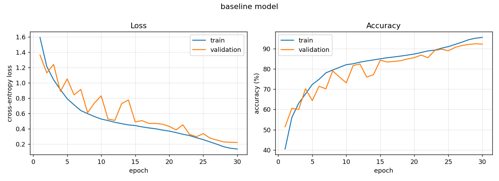
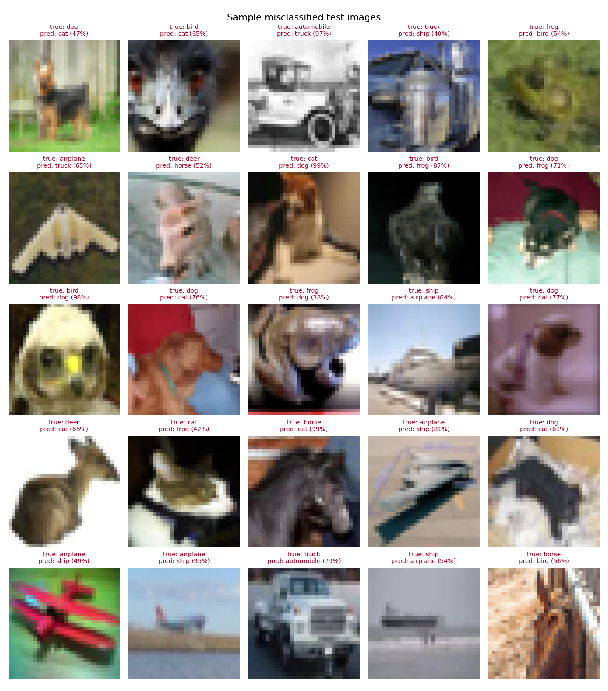
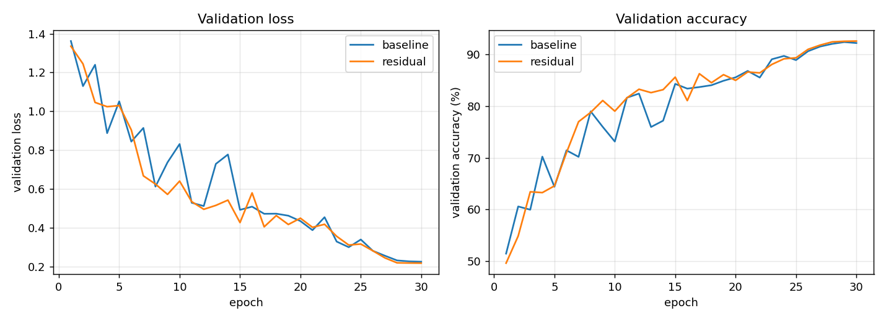

# CIFAR-10 Image Classification

A small CNN built from scratch in **PyTorch** to classify CIFAR-10 images, plus a residual-block version of the same network (Part 2, Option A), with a direct comparison of the two.

## Problem

**Objective:** build and train deep learning models using TensorFlow or PyTorch, applying best practices in data handling, model architecture, training loops and evaluation.

### Part 1: Core coding task
Build and train a neural network to classify images from the CIFAR-10 dataset.

1. **Data pipeline:** load CIFAR-10; apply standard preprocessing (normalization, augmentation, batching); show efficient data loading (`tf.data` or `torch.utils.data.DataLoader`).
2. **Model architecture:** a small CNN **from scratch** (not pre-trained) with convolutional layers, BatchNorm, Dropout and a final classification head.
3. **Training:** a clear training loop with loss computation, accuracy metrics and learning-rate scheduling; save checkpoints.
4. **Evaluation:** plot loss and accuracy curves; compute test accuracy; show sample misclassified images.
5. **Reproducibility:** set random seeds; provide an environment / requirements file.

**Deliverables:** source code (Python scripts or notebook), and a README explaining the project structure, training setup, model design decisions and how to run the code.

### Part 2: Model improvement challenge
Implement **one** of: **(A)** a residual block integrated into the CNN, **(B)** a custom callback / training utility, or **(C)** hyperparameter tuning. Provide results comparing the baseline with the improved model.

*Optional extensions:* mixed precision, distributed training, deployment (FastAPI / Flask / TF Serving), ONNX export, unit tests for model components.

---

## Solution

### Choices made

| Decision | Choice | Why |
|---|---|---|
| Framework | **PyTorch** | The task asks for a *clear training loop*. In PyTorch the loop is explicit code (forward, loss, backward, step, scheduler, metrics) rather than hidden inside `model.fit()`. It also runs natively on Apple Silicon GPUs (MPS), as well as CUDA and CPU. |
| Format | **Python scripts** (a small package and command-line entry points) | Reproducible (no hidden notebook state or cells run out of order), testable with `pytest`, clean diffs in git, and the whole pipeline runs with one command. The plots are saved as images and shown below. |
| Part 2 | **Option A: residual block** | A controlled experiment. The baseline and the improved model share the same backbone, depth, channel widths, data pipeline, seed and hyperparameters. **The only change is the skip connection**, so any difference in results comes from it. |
| Optional extensions | **All five**: mixed precision, DDP, FastAPI deployment, ONNX export and inference, unit tests | See [Optional extensions](#optional-extensions) for what was implemented, how it was verified and the measured results. |

### Results

Both models were trained for 30 epochs with identical settings (seed 42) on an Apple M5 GPU (MPS). The full training log is in [`results/training_log.txt`](results/training_log.txt).

| Model | Parameters | **Test accuracy** | Test loss | Best val accuracy | Best epoch | Train time |
|---|---|---|---|---|---|---|
| Baseline (plain CNN) | 1,148,874 | **91.77%** | 0.2448 | 92.38% | 29/30 | 10.4 min |
| Residual (Part 2, Option A) | 1,190,922 | **91.79%** | 0.2387 | 92.58% | 30/30 | 14.1 min |

<details>
<summary>Per-class test accuracy</summary>

| Class | Baseline | Residual |
|---|---|---|
| airplane | 92.90% | 93.40% |
| automobile | 96.30% | 95.60% |
| bird | 86.70% | 85.50% |
| cat | 81.90% | 81.10% |
| deer | 92.80% | 93.60% |
| dog | 87.20% | 88.10% |
| frog | 95.40% | 94.60% |
| horse | 93.70% | 94.30% |
| ship | 96.10% | 96.60% |
| truck | 94.70% | 95.10% |

</details>

#### Loss and accuracy curves (baseline)


The residual model's curves are in [`results/residual/curves.png`](results/residual/curves.png). Train and validation accuracy stay close (95.5% vs 92.2% at the end), so augmentation, dropout and weight decay keep overfitting small. The validation curve is bumpy in the middle epochs, while the learning rate is near its peak of 0.1, and smooths out as OneCycle lowers it.

#### Sample misclassified test images (baseline)


The [confusion matrix](results/baseline/confusion_matrix.png) shows the most common mistakes are, by far, **cat → dog (79 images) and dog → cat (70)**. Cat is the weakest class, at about 82%. Next come bird → deer / frog and cat → frog (29 each), then vehicle pairs: truck ↔ automobile and airplane → ship. These are visually similar classes at 32×32 resolution, often against similar backgrounds (grass, sky, water).

#### Part 2: Baseline vs residual


**Findings:**
1. **Final accuracy is the same:** 91.77% vs 91.79% (+0.02 percentage points). With a single seed, that is well within normal run-to-run variation, so the residual block **did not measurably improve final accuracy** for this network.
2. **Slightly lower test loss** (0.2448 → 0.2387) and best validation accuracy (92.38% → 92.58%).
3. **More stable training at a high learning rate.** During the high-LR phase, the baseline's validation accuracy drops sharply several times (epoch 10: 73.1%, epoch 13: 76.0%), while the residual model stays steadier (79.0% and 82.6% at those epochs). Its mean validation accuracy over the first 15 epochs is 73.3% vs 71.9%. The skip connections give gradients a direct path, which makes optimization smoother.
4. **Cost:** about 4% more parameters (the 1×1 projection shortcuts) and about 35% longer training on MPS.

**Why there's no larger gain:** residual connections mainly solve the *degradation problem* of **deep** networks, where stacking more plain layers makes them harder to optimize. This network has only 6 conv layers, and BatchNorm plus OneCycle already make a plain network this shallow easy to train. So the skip connections help stability rather than final accuracy. A deeper network, with more blocks per stage, is where the residual version would be expected to pull clearly ahead.

### Optional extensions

All five optional extensions are implemented and were run on this machine (Apple M5, a single GPU).

#### 1. Mixed-precision training (`--amp`)
The forward pass runs under `torch.autocast` in **float16** (on CUDA or MPS), or bfloat16 on the CPU. A `GradScaler` multiplies the loss before backpropagation so that small float16 gradients don't round down to zero; it also adjusts the scale automatically if values overflow. The scaler state is saved in `last.pt`, so `--resume` works.

```bash
python train.py --model residual --amp --run-name residual_amp
```

| Run (residual model, 30 epochs, same seed) | Test accuracy | Test loss | Median epoch time | Total train time |
|---|---|---|---|---|
| float32 | 91.79% | 0.2387 | 28.5 s | 14.1 min |
| **mixed precision (float16)** | **92.07%** | 0.2397 | 27.0 s | 13.1 min |

**No loss of accuracy** (the +0.28 pp is within run-to-run noise) and about **7% faster** on the Apple M5. The gain on MPS is modest: with a model this small, much of each epoch goes to loading and augmenting images on the CPU. On NVIDIA GPUs with Tensor Cores, float16 usually gives a much larger speed-up and halves activation memory. Full table: [`results/comparison_amp.md`](results/comparison_amp.md). Log: [`results/training_log_amp.txt`](results/training_log_amp.txt).

#### 2. Distributed training (DDP)
`train.py` detects when it is launched by `torchrun` and switches to **DistributedDataParallel**:
- `init_process_group` uses **NCCL** on CUDA GPUs, and **gloo** on the CPU, because MPS doesn't support DDP.
- A `DistributedSampler` gives each process a different 1/N shard of the training set, reshuffled every epoch with `set_epoch`.
- DDP averages the gradients across processes after every backward pass, so all the model copies stay identical. The same seed on every rank gives identical starting weights.
- The training loss and accuracy are combined with `all_reduce`, so the logs show global numbers. Only **rank 0** validates, logs and writes checkpoints. Checkpoints store the unwrapped `model.module` weights, so they load without DDP.

```bash
torchrun --nproc_per_node=4 train.py --model residual     # e.g. 4 GPUs: batch size 128 per GPU
```

**Verification:** this machine has a single Apple GPU, so a multi-GPU speed-up could not be measured. The code was run with **2 processes on the CPU (gloo backend)**: `torchrun --nproc_per_node=2 train.py --model residual --epochs 2 --train-subset 4000 --batch-size 64`. Each process received 31 batches of 64 images (2 × 31 × 64 = 3,968 of the 4,000 images, so the training images were split across the processes with no overlap). Training converged, rank 0 alone logged and saved, and the checkpoint loads like a normal one. On a multi-GPU CUDA machine, the same command uses NCCL with no code changes.

#### 3. ONNX export and inference (`export_onnx.py`)
The trained residual model is exported to [`checkpoints/residual/model.onnx`](checkpoints/residual/model.onnx) (opset 17, dynamic batch size) and validated with `onnx.checker`. The script then runs all **10,000 test images** through both PyTorch and **ONNX Runtime**:

| Check | Result |
|---|---|
| Prediction agreement, PyTorch vs ONNX Runtime | **100%** (10,000 / 10,000) |
| Test accuracy, PyTorch vs ONNX Runtime | 91.79% vs **91.79%** |
| Largest difference in any output score | 4.6 × 10⁻⁵ (float rounding) |
| CPU latency, 1 image: PyTorch vs ONNX Runtime | 0.84 ms vs 1.40 ms |
| CPU latency, batch of 256: PyTorch vs ONNX Runtime | 268 ms vs 318 ms |

On this Apple Silicon CPU, PyTorch is slightly faster than ONNX Runtime's default CPU provider. The point of ONNX here is **portability**: the deployed model needs only `onnxruntime` and numpy (no PyTorch), and runs from other languages and runtimes. Metrics: [`results/residual/onnx_metrics.json`](results/residual/onnx_metrics.json). *(The legacy TorchScript-based exporter is used, `dynamo=False`. It is stable for this model and needs no extra dependency. PyTorch 2.9+ defaults to the new `torch.export`-based exporter.)*

#### 4. Deployment with FastAPI (`serve.py`)
A FastAPI service loads the ONNX model **once at startup** and serves:

| Endpoint | Purpose |
|---|---|
| `GET /` | A small upload page: choose a photo and see the predicted class with the top-3 probabilities |
| `POST /predict` | Upload an image (any size or format; it is resized to 32×32 and normalized exactly as in training). Returns the label, confidence and top 3 |
| `GET /health` | Health check |
| `GET /docs` | Interactive API documentation (generated automatically) |

```bash
uvicorn serve:app --port 8080
curl -F "file=@cat.png" http://localhost:8080/predict
# {"filename":"cat.png","label":"cat","confidence":0.81,"top_k":[{"label":"cat","probability":0.81},{"label":"dog","probability":0.1878},...]}
```

Invalid files return `400`, and uploads over 5 MB return `413`. The serving code (`cifar10/inference.py`, `cifar10/constants.py`) doesn't import PyTorch.

#### 5. Unit tests
`python -m pytest -q` runs **19 tests** in about 9 seconds (see [Unit tests](#unit-tests)).

### Limitations: real-world photos

The 92% accuracy applies to **CIFAR-10-style images**. Photos uploaded to the API can fail even with high confidence. For example, a photo of a **white horse rearing up against a pale sky** was classified as *bird (97%)*:

- **Distribution shift:** CIFAR-10 horses are mostly brown or dark, standing side-on, on grass or dirt. Only about 6% of training horses are as bright and colourless as that photo, compared with about 25% of airplanes. Birds and airplanes are usually photographed against the sky, so at 32×32 a pale shape with spread-out limbs on a bright background looks like them.
- **Resolution:** shrinking to 32×32 removes the details (head, mane, hooves) that would identify the horse, leaving mostly colour and outline.
- **Overconfidence:** softmax probabilities must add up to 100% across the 10 classes, even for unfamiliar inputs, and neural networks are typically overconfident on such inputs. The prediction was also unstable: slightly different crops of the same photo gave *airplane 54%* or *bird 57%*.

Possible improvements: colour-jitter and greyscale augmentation (so the model can't rely on "horses are brown"), temperature scaling to calibrate the confidence values, and a low-confidence warning in the app. A model pre-trained on large, high-resolution datasets would handle such photos far better, but the assignment requires a model trained from scratch.

### Project structure

```
cifar10-classification/
├── cifar10/                  # Library code
│   ├── constants.py          # Class names, normalization mean/std (no torch import)
│   ├── data.py               # Dataset, transforms, train/val split, DataLoaders (+ DistributedSampler)
│   ├── models.py             # PlainBlock, ResidualBlock, CifarCNN backbone, build_model()
│   ├── engine.py             # train_one_epoch() (AMP, DDP-aware), evaluate(), predict()
│   ├── inference.py          # ONNX export, preprocessing, ONNX Runtime classifier
│   ├── plots.py              # Curves, misclassified grid, confusion matrix, comparison plot
│   └── utils.py              # Seeding, device selection, checkpoint save/load
├── train.py                  # CLI: train (single device, --amp, or torchrun for DDP) and save checkpoints
├── evaluate.py               # CLI: test accuracy, per-class accuracy and plots for a checkpoint
├── compare.py                # CLI: comparison table and plot for several runs
├── export_onnx.py            # CLI: export to ONNX, verify against PyTorch, benchmark
├── serve.py                  # FastAPI app: upload page, /predict, /health
├── run_all.sh                # Train, evaluate and compare the baseline and residual models
├── tests/                    # pytest unit tests
├── checkpoints/<run>/        # best.pt per run (baseline, residual, residual_amp); residual/model.onnx
├── results/                  # metrics, history and plots per run; comparison tables; training logs
├── pytest.ini
└── requirements.txt          # Pinned dependencies
```

### Data pipeline (`cifar10/data.py`)

- **Loading:** `torchvision.datasets.CIFAR10` downloads the dataset to `data/` on first run.
- **Train / validation / test split:** the 50,000 training images are split by a fixed seed into **45,000 training** and **5,000 validation** images. Validation chooses the best checkpoint, so the **10,000 test images are used only once**, for the final score. This avoids tuning on the test set.
- **Preprocessing:** `ToTensor` followed by `Normalize` with the per-channel mean and standard deviation of the CIFAR-10 training set.
- **Augmentation (training only):** `RandomCrop(32, padding=4, reflect)` and `RandomHorizontalFlip`. These are the standard CIFAR augmentations, so the model learns to cope with small shifts and mirroring. Validation and test images use a separate, non-augmented view of the data.
- **Efficient loading:** `DataLoader` with 4 worker processes, `persistent_workers=True` (workers are not restarted every epoch), `prefetch_factor=4` (batches are prepared ahead of the GPU), `pin_memory` on CUDA, and larger batches for evaluation. In the training loop, the loss and accuracy are added up on the GPU and read back once per epoch, so the CPU doesn't wait for the GPU after every batch.

### Model design (`cifar10/models.py`)

Both models use one backbone, `CifarCNN`, and differ only in the block used in each stage:

```
Input 3×32×32
 ├─ Stage 1: Block(3 → 64)    → MaxPool(2) → Dropout(0.1)    64×16×16
 ├─ Stage 2: Block(64 → 128)  → MaxPool(2) → Dropout(0.1)   128×8×8
 ├─ Stage 3: Block(128 → 256) → MaxPool(2) → Dropout(0.1)   256×4×4
 └─ Head: GlobalAvgPool → Dropout(0.3) → Linear(256 → 10)
```

| Block | Definition |
|---|---|
| `PlainBlock` (baseline) | `Conv3×3 → BN → ReLU → Conv3×3 → BN → ReLU` |
| `ResidualBlock` (improved) | `ReLU( BN(Conv3×3(ReLU(BN(Conv3×3(x))))) + shortcut(x) )`. The shortcut is a 1×1 Conv + BN projection when the channel count changes, otherwise the identity |

**Design decisions**
- **Conv → BatchNorm → ReLU, convolutions without bias:** BatchNorm already learns a shift, so a bias would be redundant. BatchNorm keeps activations well scaled, which allows a high learning rate.
- **Channels double as the resolution halves (64 → 128 → 256):** the standard VGG/ResNet pattern. It keeps the compute per stage roughly balanced and gives about 1.2M parameters, small and quick to train.
- **Global average pooling head** instead of flattening a large feature map: far fewer parameters in the classifier (256×10 instead of 4096×10), which means less overfitting.
- **Dropout in two places:** light (0.1) after each stage and stronger (0.3) before the classifier. Together with data augmentation and weight decay, this regularizes the model without slowing training much.
- **Kaiming (He) initialization** for the conv layers, which suits ReLU networks.
- **Fair comparison:** the residual model adds only the 1×1 projection shortcuts, about 3% more parameters (checked in a unit test). Depth, widths and everything else are identical.

### Training setup (`train.py`, `cifar10/engine.py`)

| Setting | Value | Reason |
|---|---|---|
| Loss | Cross-entropy | Standard for multi-class classification |
| Optimizer | SGD, momentum 0.9, Nesterov, weight decay 5e-4 | Generalizes better than Adam on CIFAR-style CNNs |
| LR schedule | **OneCycleLR**, peak 0.1, stepped **per batch** | Warm-up for the first 30% of steps, then cosine decay: fast and stable convergence in few epochs |
| Epochs / batch size | 30 / 128 | About 16 minutes per model on an Apple M5 GPU |
| Metrics | Loss and accuracy for train and validation each epoch, saved to `history.json` | Used for the curves and for choosing the checkpoint |
| Checkpoints | `last.pt` every epoch (model, optimizer, scheduler, history; used by `--resume`) and `best.pt` whenever validation accuracy improves | Training can resume after an interruption; evaluation uses the best model |
| Seeds | `random`, `numpy`, `torch` (CPU/CUDA/MPS), DataLoader generator and worker seeds, deterministic cuDNN | Reproducible split, initialization, shuffling and augmentation |

**The training loop for each batch:** move the batch to the device → `zero_grad` → forward pass → cross-entropy loss → `backward` → `optimizer.step()` → `scheduler.step()` → update the running loss and accuracy. After each epoch: evaluate on the validation set (with `model.eval()` and `torch.no_grad()`), log, and save checkpoints.

## How to run

```bash
cd cifar10-classification
python3 -m venv .venv && source .venv/bin/activate
pip install -r requirements.txt

# Everything: train both models, evaluate on the test set, compare (about 35 minutes on an Apple M5)
./run_all.sh

# Or step by step
python train.py --model baseline           # add --epochs, --lr, --batch-size, --device, --resume ...
python train.py --model residual
python evaluate.py --model baseline        # writes results/baseline/{metrics.json, *.png}
python evaluate.py --model residual
python compare.py                          # writes results/comparison.{md,png}

# Optional extensions
python train.py --model residual --amp --run-name residual_amp      # mixed precision
torchrun --nproc_per_node=2 train.py --model residual                # DDP (one process per GPU)
python export_onnx.py --run residual                                 # ONNX export + verification
uvicorn serve:app --port 8080                                        # API at http://localhost:8080

# Unit tests
python -m pytest -q
```

The best checkpoints are committed in `checkpoints/<run>/best.pt` (about 5 MB each), along with `checkpoints/residual/model.onnx`, so `evaluate.py`, `export_onnx.py` and `serve.py` all work **without retraining**. The dataset downloads automatically on first use. The device is chosen automatically (CUDA, then MPS, then CPU) and can be forced with `--device`.

**Reproducibility note:** with the same seed and hardware, the data split, initialization and augmentation order are identical. Some GPU kernels (CUDA, MPS) aren't bit-for-bit deterministic, so accuracy may differ by a few tenths of a percent between runs or machines.

## Unit tests

`python -m pytest -q` runs 19 tests:
- **Models:** the output shape for both models; Conv, BatchNorm, Dropout and a Linear head are all present; residual block shapes, and identity vs projection shortcut; with its conv branch zeroed, the residual block reduces to `ReLU(x)`; the residual model adds no more than 5% parameters over the baseline; gradients reach the first layer; the same seed gives the same initialization.
- **Data:** the train/val split is disjoint, complete and deterministic; transforms produce normalized `3×32×32` tensors; `denormalize` undoes the normalization.
- **Training loop:** the full loop can overfit a tiny batch (100% accuracy), a standard sanity check.
- **ONNX and serving:** ONNX Runtime matches PyTorch outputs (batch sizes 1 and 7); serving preprocessing matches the training transforms exactly; images of any size and mode are handled; predictions are sorted; the API returns predictions from `/predict`, rejects files that aren't images (`400`), and serves `/health` and the upload page.
